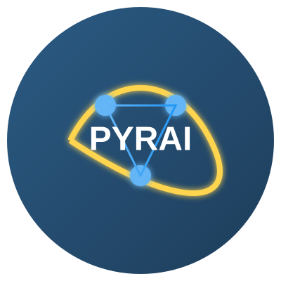

<p align="center">
  
</p>

> "Life is short, you need Python!"  
> -- Bruce Eckel

# PYRAI - Python Reinforced AI Infrastructure

[](https://github.com/pyraixyz/pyrai/actions/workflows/tests.yml)
[](https://pyrai.readthedocs.io/en/latest/?badge=latest)
[](https://badge.fury.io/py/pyrai)
[](https://opensource.org/licenses/MIT)

> **Project Status**: PYRAI is currently in its initial development phase (Alpha). While we are working diligently to improve the platform, you may encounter bugs and limitations. We appreciate your understanding and welcome any feedback or contributions to help make PYRAI better.

PYRAI (technically referred to as PyRAI in development contexts) is a revolutionary distributed AI infrastructure built on blockchain technology, enabling decentralized machine learning and AI model training. Our mission is to democratize AI development by providing a secure, scalable, and efficient platform for distributed computing and model training.

## What is PYRAI?

PYRAI is a comprehensive platform that combines the power of Python, blockchain technology, and distributed computing to create a new paradigm for AI development and deployment. It provides:

1. **Decentralized Computing Network**: A global network of nodes that contribute computing resources for AI model training
2. **Blockchain-Based Verification**: Ensures the integrity and traceability of AI models
3. **Token Economics**: Incentivizes network participants through a fair reward system
4. **Python-First Development**: Seamless integration with the Python ecosystem

## Why Choose PYRAI?

- 🚀 **Distributed Training**: Train large models across multiple nodes
- 🔗 **Blockchain Security**: Immutable record of model versions and training data
- 💰 **Cost Effective**: Pay only for the computing resources you use
- 🔒 **Privacy Focused**: Keep your data and models secure
- 📊 **Real-time Monitoring**: Track training progress and performance
- 🌐 **Global Access**: Connect to computing resources worldwide

## Technical Architecture

PYRAI is built on a multi-layer architecture:

```
PYRAI Architecture
├── Infrastructure Layer
│   ├── Blockchain Network (Solana-based)
│   ├── Distributed Computing Network
│   └── Storage Layer (IPFS)
├── Core Layer
│   ├── Model Management
│   ├── Resource Scheduling
│   └── Security Protocol
├── Service Layer
│   ├── API Services
│   ├── SDK
│   └── CLI Tools
└── Application Layer
    ├── Web Interface
    ├── Monitoring Tools
    └── Developer Tools
```

## Core Components

The main components of PYRAI are:

```
pyrai/
├── core/                 # Core engine components
│   ├── engine.py        # Main processing engine
│   ├── scheduler.py     # Resource scheduler
│   └── validator.py     # Model validation
├── blockchain/          # Blockchain integration
│   ├── contracts/       # Smart contracts
│   ├── network.py      # Network interface
│   └── verification.py # Model verification
├── api/                # API services
│   ├── rest/          # REST API endpoints
│   └── grpc/          # gRPC services
├── sdk/               # SDK tools
│   ├── client.py     # Client interface
│   └── utils.py      # Utility functions
├── cli/              # Command line tools
│   └── commands/     # CLI commands
└── utils/            # Utility functions
    ├── crypto.py    # Cryptographic utilities
    └── logging.py   # Logging utilities
```

## How It Works

1. **Model Preparation**:
   - Developers prepare their AI models using standard Python frameworks
   - PYRAI SDK provides tools for model optimization and distribution

2. **Resource Allocation**:
   - The scheduler identifies available computing resources in the network
   - Smart contracts manage resource allocation and pricing

3. **Distributed Training**:
   - Models are trained across multiple nodes in parallel
   - Progress is monitored in real-time
   - Results are validated using blockchain consensus

4. **Model Deployment**:
   - Trained models are verified and stored on IPFS
   - Model metadata is recorded on the blockchain
   - Deployment is managed through smart contracts

## Installation

```bash
pip install pyrai
```

## Quick Start

1. Initialize a new PYRAI node:

```python
from pyrai import Node

node = Node()
node.start()
```

2. Train a model:

```python
from pyrai.models import DistributedModel

model = DistributedModel()
model.train(data, epochs=10)
```

3. Deploy to blockchain:

```python
from pyrai.blockchain import deploy_model

tx_hash = deploy_model(model)
print(f"Model deployed: {tx_hash}")
```

## Development Status

PYRAI is being developed by a team of AI enthusiasts who currently work at leading tech companies. Due to their commitments and confidentiality agreements, they can only work on this project during their personal time and cannot disclose their full identities. The development process is supported by modern AI-powered development tools, including advanced IDEs and coding assistants, to maintain high code quality and development efficiency.

## Development Tools

- **AI-Assisted Development**: Utilizing cutting-edge AI IDEs and coding assistants
- **Automated Testing**: Comprehensive test suite with CI/CD integration
- **Code Quality**: Automated code review and quality checks
- **Documentation**: AI-assisted documentation generation

## Documentation

Full documentation is available at [https://pyrai.readthedocs.io/](https://pyrai.readthedocs.io/)

## Security

For security issues, please email security@pyrai.xyz instead of opening a public issue.

## Support

- Documentation: https://pyrai.readthedocs.io/
- Discord: https://discord.gg/pyrai
- Twitter: [@PYRAI_xyz](https://x.com/PYRAI_xyz)
- Email: support@pyrai.xyz
- Website: https://www.pyrai.xyz/

## Contributing

We welcome contributions! Please see our [Contributing Guidelines](CONTRIBUTING.md).

1. Fork the repository
2. Create your feature branch (`git checkout -b feature/amazing-feature`)
3. Commit your changes (`git commit -m 'Add amazing feature'`)
4. Push to the branch (`git push origin feature/amazing-feature`)
5. Open a Pull Request

## Community

- [Discord](https://discord.gg/pyrai)
- [Twitter](https://x.com/PYRAI_xyz)
- [Website](https://www.pyrai.xyz/)
- [Blog](https://blog.pyrai.xyz)

## Citation

If you use PYRAI in your research, please cite:

```bibtex
@software{pyrai2024,
  title={PYRAI: High-Performance AI Training with Blockchain Integration},
  author={PYRAI Team},
  year={2024},
  url={https://github.com/pyraixyz/pyrai}
}
```

## Acknowledgments

- [Solana](https://solana.com) for blockchain infrastructure
- [PyTorch](https://pytorch.org) for deep learning framework
- [Ray](https://ray.io) for distributed computing
- All the amazing open-source projects that make PYRAI possible

## License

This project is licensed under the MIT License - see the [LICENSE](LICENSE) file for details.

---

**Note**: This project is under active development. While we strive for stability, some features may be experimental or subject to change. We appreciate your patience and support as we work to improve PYRAI. 